# Predicting Annual Income from Census Data

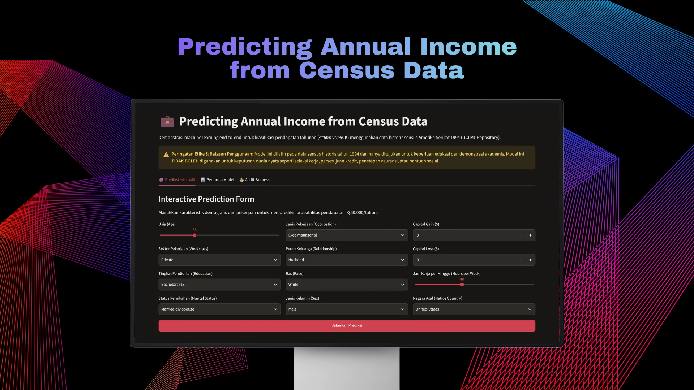


## Project Overview

Predicting Annual Income from Census Data is an end-to-end supervised machine learning classification project built on the 1994 US Adult Census Income dataset from the UCI Machine Learning Repository. The project predicts whether an individual's annual income exceeds USD 50,000 (`>50K`) or remains at or below USD 50,000 (`<=50K`) from demographic, educational, employment, and capital investment attributes. Beyond predictive modeling, the repository implements leakage-free preprocessing pipelines, systematic multi-algorithm benchmarking, hyperparameter tuning, permutation-based interpretability, demographic fairness auditing across `sex` and `race`, automated unit/integration tests, and an interactive Streamlit inference and diagnostic interface. The system is designed strictly as an academic and methodological benchmark rather than a decision-making tool for real-world human screening.

## Problem Statement & Objectives

Tabular socioeconomic classification on census records presents several methodological challenges: class imbalance (`<=50K` accounts for 76.06% of cleaned records while `>50K` accounts for 23.94%), missing categorical entries encoded as `?` placeholders, redundant or non-predictive survey fields (`education` vs. `education-num` and sampling weight `fnlwgt`), extreme zero-inflation with `$99,999` top-coding in capital gains, and the risk of amplifying historical demographic disparities.

- Formulate a leakage-free binary classification pipeline (`<=50K` vs. `>50K`) with stratified train-test splitting prior to any imputation, scaling, or encoding.
- Benchmark five model families (Dummy baseline, Logistic Regression, Decision Tree, Random Forest, and HistGradientBoosting) under both default and `class_weight="balanced"` configurations using 5-fold stratified cross-validation.
- Optimize the top candidate (`HistGradientBoostingClassifier`) via `GridSearchCV` using Precision-Recall AUC (Average Precision) as the primary selection criterion for the minority positive class.
- Evaluate generalization once on a held-out test set (`N = 9,758`) alongside permutation feature importance and a subgroup fairness audit comparing full and attribute-ablated models.
- Deliver reproducible CLI and Streamlit interfaces backed by automated pipeline integrity tests.

## Data & Input Sources

The project uses the Adult Census Income dataset (`dataset/original/Adult.csv`, metadata in `dataset/original/metadata.json`), extracted by Barry Becker and Ronny Kohavi from the 1994 US Census database (UCI ID 2, DOI `10.24432/C5XW20`). Raw records contain 48,842 observations across 14 predictor columns and 1 target column (`income`). After string whitespace trimming, `?` placeholder normalization, target label normalization (stripping trailing `.`), and removal of 52 exact duplicate rows, the cleaned dataset comprises 48,790 observations.

| Attribute | Description |
| :--- | :--- |
| Dataset / Input Source | Adult Census Income (`Adult.csv`) |
| Source | UCI Machine Learning Repository (`dataset/original/Adult.csv`) |
| Format | CSV (`Adult.csv`) and JSON metadata (`metadata.json`) |
| Samples / Records | 48,842 raw rows; 48,790 cleaned rows (39,032 train / 9,758 test) |
| Features / Input Shape | 14 raw attributes (12 retained predictors: 5 numeric, 7 categorical) |
| Target / Label | `income` (`<=50K`: 37,109 [76.06%]; `>50K`: 11,681 [23.94%]) |

## Data Preprocessing & Feature Engineering

Data cleaning and feature transformation are modularized in [src/data_preprocessing.py](src/data_preprocessing.py) to guarantee zero data leakage between training folds and the held-out test set. All fitted transformers (`SimpleImputer`, `StandardScaler`, and `OneHotEncoder`) are encapsulated inside a unified `ColumnTransformer` within a scikit-learn `Pipeline`.

| Transformation | Input Features | Output / Behavior |
| :--- | :--- | :--- |
| String Normalization & Missing Mapping | All object/string columns | Strips whitespace; converts `?`, `nan`, and `None` to `np.nan` |
| Target Normalization | `income` | Strips trailing `.` (`<=50K.` → `<=50K`, `>50K.` → `>50K`) and asserts binary labels |
| Exact Deduplication | Full cleaned DataFrame | Removes 52 identical rows (`48,842` → `48,790`) to prevent cross-split leakage |
| Redundant & Noise Feature Removal | `education`, `fnlwgt` | Drops `education` (1:1 bijection with `education-num`) and `fnlwgt` (`r = -0.006` sampling weight) |
| Numeric Pipeline | `age`, `education-num`, `capital-gain`, `capital-loss`, `hours-per-week` | `SimpleImputer(strategy="median")` followed by `StandardScaler()` |
| Categorical Pipeline | `workclass`, `marital-status`, `occupation`, `relationship`, `race`, `sex`, `native-country` | `SimpleImputer(strategy="most_frequent")` followed by `OneHotEncoder(handle_unknown="ignore", sparse_output=False)` |

1. Load `Adult.csv` and trim leading/trailing whitespace across string columns.
2. Convert `?`, `nan`, and `None` strings into standard `np.nan` values without dropping incomplete rows (`occupation`: 2,805 missing; `workclass`: 2,795 missing; `native-country`: 856 missing after deduplication).
3. Normalize target labels by stripping trailing periods and remove 52 identical duplicate rows.
4. Drop `education` and `fnlwgt`, then perform an 80:20 stratified split (`random_state=42`) before fitting any preprocessing statistics.
5. Fit the `ColumnTransformer` exclusively on training folds during cross-validation and final model fitting.

## Tech Stack

| Category | Technology | Purpose |
| :--- | :--- | :--- |
| Language | Python | Core scripting, modeling, testing, and application logic |
| ML Framework | Scikit-Learn | Preprocessing pipelines, model training, GridSearchCV, metrics, and permutation importance |
| Data Processing | Pandas, NumPy, SciPy | Tabular data loading, cleaning, statistical summaries, and array operations |
| Visualization | Matplotlib, Seaborn | Publication-grade EDA, evaluation curves, feature importance, and fairness plots |
| Serialization | Joblib | Persisting and loading the fitted scikit-learn pipeline (`best_income_pipeline.joblib`) |
| Interactive UI | Streamlit | Web dashboard for interactive predictions, model comparisons, and fairness auditing |
| Testing | Pytest, Unittest | Automated pipeline verification for data cleaning, splitting, unseen categories, and inference |
| Notebook | Jupyter Notebook | Interactive exploratory data analysis and experiment documentation |

## Machine Learning Approach

The project addresses a supervised binary classification problem on mixed-type tabular census data. Because the positive class (`>50K`) represents 23.94% of observations, standard accuracy alone can be misleading; therefore, candidate selection and hyperparameter optimization prioritize ranking and precision-recall quality (`PR-AUC` / Average Precision and `ROC-AUC`) alongside `F1_Positive` and `Balanced_Accuracy`.

| Attribute | Value |
| :--- | :--- |
| Learning Paradigm | Supervised Learning |
| Problem Domain | Tabular Socioeconomic Census Classification |
| ML Task | Binary Classification (`<=50K` vs. `>50K`) |
| Input Representation | 5 standardized numeric features + one-hot encoded categorical features |
| Target Output | Discrete class label (`<=50K` / `>50K`) and positive class probability |
| Evaluation Strategy | 5-fold Stratified Cross-Validation (training) + single-pass held-out test evaluation |

## Model Overview

The primary production model selected by cross-validation is a tuned `HistGradientBoostingClassifier` wrapped inside a `scikit-learn` `Pipeline` (`preprocessor` + `classifier`). During model selection, it was benchmarked against four other algorithm families—including linear, single-tree, bagging ensemble, and frequency-baseline classifiers—evaluated with both default and class-balanced weighting where supported.

| Attribute | Specification |
| :--- | :--- |
| Primary Model | Best Tuned `HistGradientBoostingClassifier` |
| Model Family | Histogram-Based Gradient Boosted Decision Trees |
| Framework | Scikit-Learn (`sklearn.ensemble.HistGradientBoostingClassifier`) |
| Input | Preprocessed dense feature vector from `ColumnTransformer` |
| Output | Predicted income class (`<=50K` or `>50K`) and `predict_proba` scores |
| Pretrained Status | Trained from scratch on the 1994 US Adult Census training split (`N = 39,032`) |
| Ablation Variant | Identical tuned `HistGradientBoostingClassifier` trained without `sex` and `race` for fairness auditing |

## ML Workflow

The end-to-end workflow documented in [final_report.md](final_report.md) and [notebooks/01_exploration_and_experiments.ipynb](notebooks/01_exploration_and_experiments.ipynb) progresses through seven verified stages:

1. **Data Inspection & Cleaning** ([src/data_preprocessing.py](src/data_preprocessing.py)): Inspect raw distributions, normalize target strings, convert `?` symbols to `np.nan`, and deduplicate identical records (`48,842` → `48,790` rows).
2. **Exploratory Data Analysis & Visualization** ([src/visualization.py](src/visualization.py)): Generate 8 EDA figures (`figures/01_*` through `figures/08_*`) analyzing class balance, missingness, age, education, occupation, working hours, capital gain/loss zero-inflation, and Pearson correlations.
3. **Leakage-Free Stratified Split & Pipeline Construction** ([src/data_preprocessing.py](src/data_preprocessing.py)): Drop `education` and `fnlwgt`, split data 80:20 (`N = 39,032` train / `N = 9,758` test, `random_state=42`), and wrap `ColumnTransformer` with each classifier.
4. **5-Fold Stratified Cross-Validation** ([src/train.py](src/train.py)): Benchmark 9 candidate model configurations via out-of-fold predictions and save `dataset/cv_model_comparison.csv`.
5. **Hyperparameter Tuning & Artifact Serialization** ([src/train.py](src/train.py)): Tune `HistGradientBoostingClassifier` via 5-fold `GridSearchCV` optimizing `PR-AUC`, retrain on the full training set, and save `models/best_income_pipeline.joblib` and `models/best_model_metadata.json`.
6. **Held-Out Test Evaluation, Interpretability & Fairness Audit** ([src/evaluate.py](src/evaluate.py)): Evaluate all models once on `X_test`, compute 10-repeat permutation feature importance, run the `sex`/`race` fairness audit (comparing full vs. ablated models), export CSV reports, and generate evaluation figures (`figures/09_*` through `figures/14_*`).
7. **Inference & Interactive Dashboard** ([src/predict.py](src/predict.py), [streamlit/app.py](streamlit/app.py)): Serve single-record or batch predictions via CLI/Python API and interactive Streamlit tabs.

## ML Pipeline Architecture

The architecture enforces strict isolation between raw data ingestion, split-aware preprocessing, model selection, and downstream evaluation/serving so that no test-set statistics leak into training or imputation. Both the full model and the no-sensitive-attribute ablation pipeline share the same `build_preprocessor` factory.

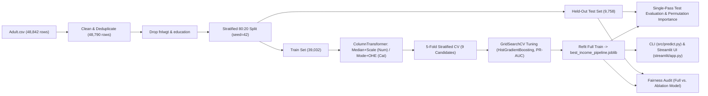

## Model Training & Configuration

Training is orchestrated by [src/train.py](src/train.py). Nine baseline and balanced candidate models are first evaluated on the training split (`N = 39,032`) using 5-fold `StratifiedKFold(n_splits=5, shuffle=True, random_state=42)` via `cross_val_predict`. The winning architecture, `HistGradientBoostingClassifier`, is then tuned and refitted on the entire training split.

| Configuration Parameter | Value | Description |
| :--- | :--- | :--- |
| Train / Test Split | 80% / 20% (`39,032` / `9,758`) | Stratified by target `income` with `random_state=42` |
| Cross-Validation Strategy | 5-Fold `StratifiedKFold` | `shuffle=True`, `random_state=42` on training set only |
| Primary Optimization Metric | `average_precision_score` (`PR-AUC`) | Evaluates ranking quality on positive class `>50K` |
| Tuned `learning_rate` | `0.08` | Shrinkage rate selected from `[0.08, 0.1, 0.12]` |
| Tuned `max_iter` | `150` | Maximum boosting iterations selected from `[100, 150]` |
| Tuned `max_leaf_nodes` | `31` | Maximum tree leaves selected from `[31, 45]` |
| Tuned `l2_regularization` | `1.0` | L2 leaf penalty selected from `[0.0, 1.0]` |
| Random State | `42` | Applied across splitting, CV shuffling, and estimators |

```python
param_grid = {
    "classifier__learning_rate": [0.08, 0.1, 0.12],
    "classifier__max_iter": [100, 150],
    "classifier__max_leaf_nodes": [31, 45],
    "classifier__l2_regularization": [0.0, 1.0],
}
```

## Hyperparameter Tuning & Experiment Tracking

Hyperparameter search is executed via `GridSearchCV` inside `tune_best_model` ([src/train.py](src/train.py)) across 24 parameter combinations (120 total fold fits) optimizing `PR-AUC` for the `>50K` class. Experiment results and selected hyperparameters are persisted to [models/best_model_metadata.json](models/best_model_metadata.json) and [dataset/cv_model_comparison.csv](dataset/cv_model_comparison.csv).

| Hyperparameter | Search Space | Selected Value |
| :--- | :--- | :--- |
| `learning_rate` | `[0.08, 0.1, 0.12]` | `0.08` |
| `max_iter` | `[100, 150]` | `150` |
| `max_leaf_nodes` | `[31, 45]` | `31` |
| `l2_regularization` | `[0.0, 1.0]` | `1.0` |
| Cross-Validation `PR-AUC` | Default HistGB: `0.8254` | Tuned HistGB: `0.8258` |

## Model Comparison & Selection

Five algorithm families (nine candidate configurations during 5-fold CV, plus the tuned `HistGradientBoostingClassifier` on the held-out test set) were systematically compared. Results from training cross-validation ([dataset/cv_model_comparison.csv](dataset/cv_model_comparison.csv)) and held-out test evaluation ([dataset/model_comparison.csv](dataset/model_comparison.csv)) confirm consistent superiority of histogram gradient boosting across ranking and composite metrics.

| Model | CV PR-AUC | CV ROC-AUC | CV Accuracy | Test PR-AUC | Test ROC-AUC | Test Accuracy |
| :--- | :---: | :---: | :---: | :---: | :---: | :---: |
| **Best Tuned HistGB** | **0.8258** | — | — | **0.8408** | **0.9327** | **0.8783** |
| HistGradientBoosting (Default) | 0.8254 | 0.9271 | 0.8706 | 0.8396 | 0.9323 | 0.8756 |
| HistGradientBoosting (Balanced) | 0.8252 | 0.9272 | 0.8323 | 0.8394 | 0.9326 | 0.8324 |
| Random Forest (Default) | 0.8019 | 0.9157 | 0.8620 | 0.8137 | 0.9212 | 0.8688 |
| Random Forest (Balanced) | 0.7924 | 0.9145 | 0.8074 | 0.7989 | 0.9173 | 0.8082 |
| Decision Tree (Default) | 0.7632 | 0.9000 | 0.8539 | 0.7733 | 0.9058 | 0.8654 |
| Logistic Regression (Default) | 0.7613 | 0.9042 | 0.8507 | 0.7683 | 0.9076 | 0.8537 |
| Logistic Regression (Balanced) | 0.7592 | 0.9042 | 0.8067 | 0.7660 | 0.9074 | 0.8065 |
| Decision Tree (Balanced) | 0.7539 | 0.8955 | 0.8000 | 0.7546 | 0.9004 | 0.7995 |
| Dummy (Most Frequent) | 0.2394 | 0.5000 | 0.7606 | 0.2394 | 0.5000 | 0.7606 |

## Model Artifacts & Checkpoints

All serialized model artifacts and empirical audit outputs are generated locally by the training and evaluation scripts and stored in `models/` and `dataset/`.

| Artifact | Format | Purpose | Location |
| :--- | :--- | :--- | :--- |
| `best_income_pipeline.joblib` | Joblib | End-to-end fitted `ColumnTransformer` + tuned `HistGradientBoostingClassifier` | [models/best_income_pipeline.joblib](models/best_income_pipeline.joblib) |
| `best_model_metadata.json` | JSON | Best CV PR-AUC score (`0.8258`) and winning `GridSearchCV` hyperparameters | [models/best_model_metadata.json](models/best_model_metadata.json) |
| `cv_model_comparison.csv` | CSV | 5-fold out-of-fold CV benchmark metrics across 9 candidate models | [dataset/cv_model_comparison.csv](dataset/cv_model_comparison.csv) |
| `model_comparison.csv` | CSV | Final held-out test-set benchmark metrics across 10 evaluated models | [dataset/model_comparison.csv](dataset/model_comparison.csv) |
| `feature_importance.csv` | CSV | 10-repeat permutation feature importance (PR-AUC decrease) on `X_test` | [dataset/feature_importance.csv](dataset/feature_importance.csv) |
| `fairness_report.csv` | CSV | Subgroup fairness metrics across `sex` and `race` for full vs. ablated models | [dataset/fairness_report.csv](dataset/fairness_report.csv) |
| `sample_predictions.csv` | CSV | 25 held-out test sample predictions with `>50K` probability scores | [dataset/sample_predictions.csv](dataset/sample_predictions.csv) |

## Model Evaluation & Results

Final evaluation was performed once on the untouched held-out test split (`N = 9,758`: 7,422 `<=50K` and 2,336 `>50K`). **Best Tuned HistGB** achieved the highest test Accuracy (`87.83%`), ROC-AUC (`0.9327`), PR-AUC (`0.8408`), positive-class F1 (`0.7293`), and Macro F1 (`0.8254`), while `HistGradientBoosting (Balanced)` achieved higher Recall (`87.37%`) and Balanced Accuracy (`84.66%`) at the expense of Precision (`60.37%`).

| Metric | Best Tuned HistGB (Test) | HistGB Default (Test) | HistGB Balanced (Test) | Dummy Baseline (Test) |
| :--- | :---: | :---: | :---: | :---: |
| Accuracy | **0.8783** | 0.8756 | 0.8324 | 0.7606 |
| Precision (`>50K`) | **0.7797** | 0.7780 | 0.6037 | 0.0000 |
| Recall (`>50K`) | 0.6849 | 0.6721 | **0.8737** | 0.0000 |
| F1-Score (`>50K`) | **0.7293** | 0.7212 | 0.7140 | 0.0000 |
| Macro F1 | **0.8254** | 0.8206 | 0.7978 | 0.4320 |
| Balanced Accuracy | 0.8120 | 0.8059 | **0.8466** | 0.5000 |
| ROC-AUC | **0.9327** | 0.9323 | 0.9326 | 0.5000 |
| PR-AUC | **0.8408** | 0.8396 | 0.8394 | 0.2394 |

- **Confusion Matrix Breakdown (`Best Tuned HistGB`)**: Out of 7,422 actual `<=50K` test records, 6,970 (93.9% specificity) were classified accurately and 452 (6.1%) were false positives; out of 2,336 actual `>50K` records, 1,600 (68.5% recall) were detected and 736 (31.5%) were false negatives.
- **Imbalance Trade-off**: Applying `class_weight="balanced"` across Logistic Regression, Decision Tree, Random Forest, and HistGradientBoosting consistently lifted recall into the 84%–87% range while reducing precision to 55%–60%, leaving ranking metrics (`ROC-AUC`, `PR-AUC`) largely unchanged.
- **Domain Limitations**: Because the data reflects 1994 US Census demographics (`$50,000` nominal threshold, 91.7% zero-inflated `capital-gain` top-coded at `$99,999`), the model captures historical statistical associations rather than causal relationships and must not be deployed for credit, hiring, insurance, or welfare decisions.

## Model Explainability & Interpretability

Model behavior was audited through 10-repeat permutation feature importance (`compute_permutation_importance` in [src/evaluate.py](src/evaluate.py), measuring mean decrease in test `PR-AUC`) and an algorithmic fairness ablation study comparing the full model against an identical model trained without `sex` and `race` ([dataset/fairness_report.csv](dataset/fairness_report.csv)).

| Rank / Dimension | Feature / Subgroup | Measured Result | Interpretation |
| :---: | :--- | :--- | :--- |
| 1 | `capital-gain` | `0.2436` ± `0.0050` PR-AUC drop | Strongest individual driver; non-zero gains strongly signal `>50K` |
| 2 | `marital-status` | `0.1376` ± `0.0044` PR-AUC drop | Second driver; `Married-civ-spouse` correlates with dual-income stability |
| 3 | `education-num` | `0.0676` ± `0.0036` PR-AUC drop | Captures monotonic rise in high-income prevalence with advanced degrees |
| 4 | `age` | `0.0631` ± `0.0039` PR-AUC drop | Reflects career tenure and prime earning years (median 43–44 vs. 34 yrs) |
| 5 | `capital-loss` | `0.0459` ± `0.0025` PR-AUC drop | Secondary investment indicator despite 95.3% zero inflation |
| Fairness Audit (`Sex`) | `Female` (`n=3,326`) vs. `Male` (`n=6,432`) | Selection Rate: `7.88%` vs. `27.83%` (Full) | Removing `sex` & `race` leaves rates nearly identical (`7.97%` vs. `27.55%`) due to proxies (`relationship`, `marital-status`, `occupation`) |
| Fairness Audit (`Race`) | `Black` (`n=916`) vs. `White` (`n=8,353`) | Recall: `52.21%` vs. `69.23%` (Full) | Reflects historical demographic disparities; small subgroups (`Amer-Indian-Eskimo` `n=94`, `Other` `n=84`) carry high sampling variance |

## Results Visualization & Preview

### 1. Streamlit Interactive Prediction Form
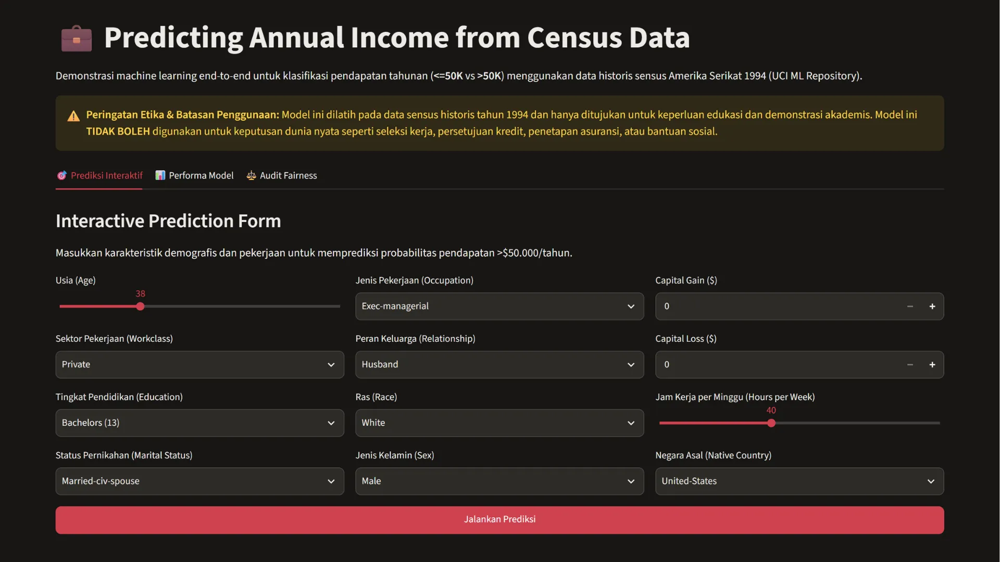
The primary input interface in `streamlit/app.py` exposes all 12 predictor features (`age`, `workclass`, `education-num`, `marital-status`, `occupation`, `relationship`, `race`, `sex`, `capital-gain`, `capital-loss`, `hours-per-week`, `native-country`) along with an academic ethics disclaimer banner warning against real-world automated decision use.

### 2. Streamlit Prediction Output & Probability Breakdown
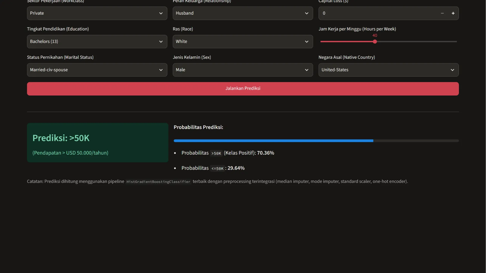
Upon submission, the application runs the serialized `HistGradientBoostingClassifier` pipeline to display the discrete predicted class (`>50K` in this example) alongside calibrated class probabilities (`70.36%` for `>50K` vs. `29.64%` for `<=50K`) and a visual progress bar.

### 3. Streamlit Model Performance & Comparison Dashboard
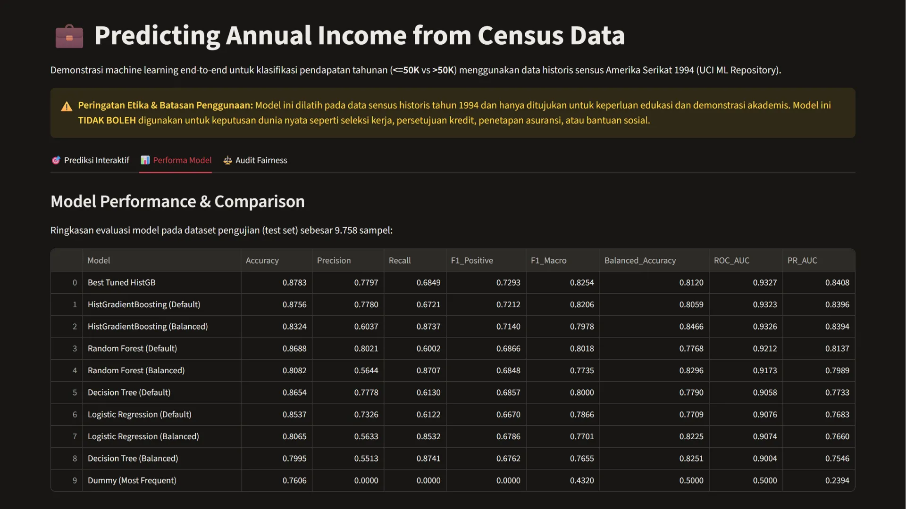
The performance tab renders `model_comparison.csv` across all 10 evaluated models on the 9,758-sample test set, highlighting `Best Tuned HistGB` at the top with `0.8783` Accuracy, `0.9327` ROC-AUC, and `0.8408` PR-AUC.

### 4. Streamlit Fairness & Demographic Disparity Audit View
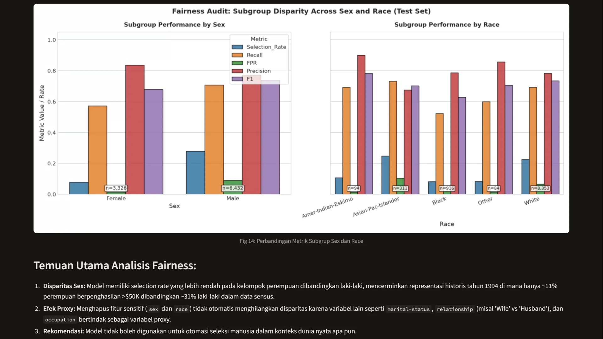
The fairness tab visualizes subgroup disparities across `sex` and `race` alongside analytical findings explaining why omitting sensitive attributes fails to eliminate bias when proxy features such as `marital-status`, `relationship`, and `occupation` remain present.

### 5. Age & Weekly Working Hours Distributions by Income Class
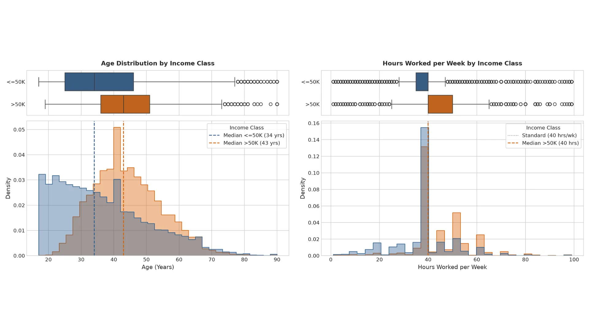
Boxplots and density histograms show that `>50K` earners concentrate in prime career ages (median 43 years vs. 34 years for `<=50K`) and exhibit a heavier right tail between 45 and 60 weekly working hours above the 40-hour standard baseline.

### 6. Permutation Feature Importances on Held-Out Test Set
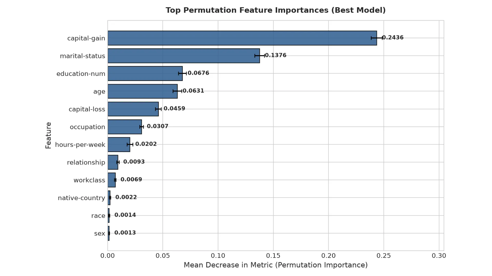
Horizontal bar chart of 10-repeat permutation importance (mean PR-AUC decrease) confirms `capital-gain` (`0.2436`) and `marital-status` (`0.1376`) as the dominant predictive signals, whereas `race` (`0.0014`) and `sex` (`0.0013`) show minimal direct permutation impact.

### 7. Income Class Proportions Across Education Levels
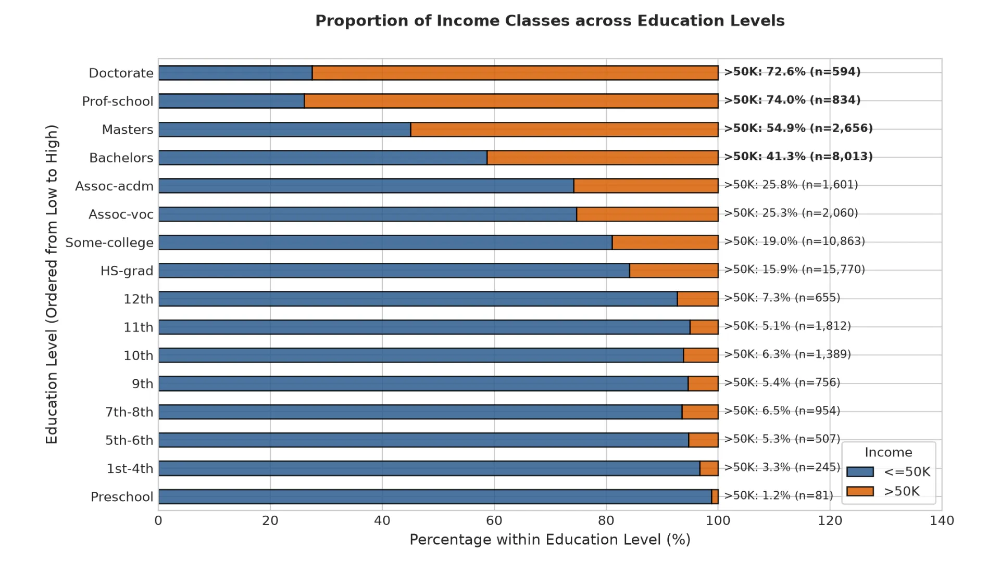
Ordered stacked horizontal bars reveal a strong monotonic association between educational attainment and earning `>50K`, rising from `1.2%` (`Preschool`) and `15.9%` (`HS-grad`) to `41.3%` (`Bachelors`), `54.9%` (`Masters`), `72.6%` (`Doctorate`), and `74.0%` (`Prof-school`).

### 8. Occupation Categories Sorted by High-Income Prevalence
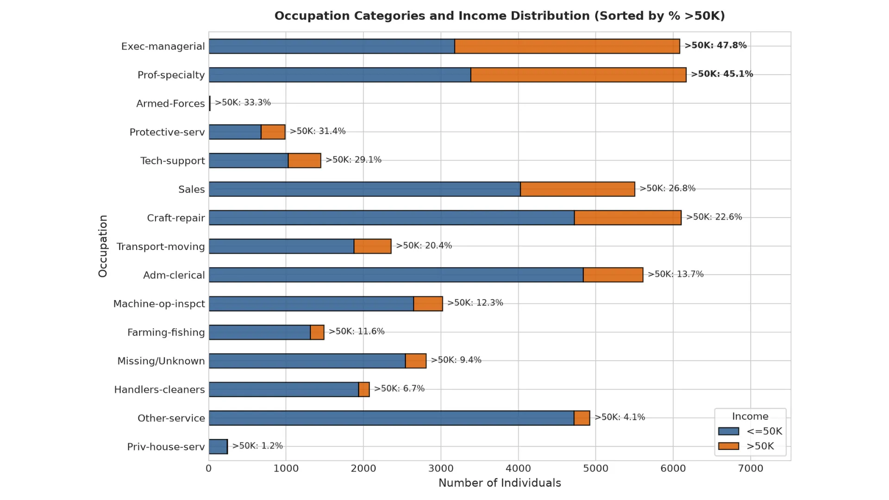
Sorted occupational counts highlight steep stratification across job sectors, led by `Exec-managerial` (`47.8%` `>50K`) and `Prof-specialty` (`45.1%` `>50K`), while service-oriented roles such as `Other-service` (`4.1%`) and `Priv-house-serv` (`1.2%`) fall well below 10%.

### 9. Target Class Balance & Feature Missingness Audit
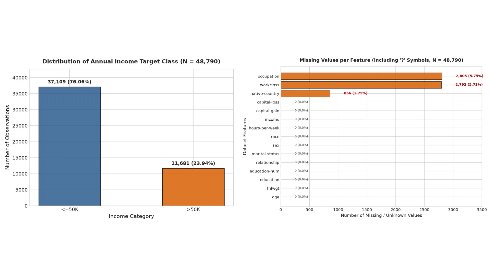
The cleaned dataset (`N = 48,790`) displays a 3.18:1 class imbalance (`76.06%` `<=50K` vs. `23.94%` `>50K`), while missing or `?`-encoded values are confined exclusively to three categorical columns: `occupation` (`5.75%`), `workclass` (`5.73%`), and `native-country` (`1.75%`).

### 10. Capital Gain & Capital Loss Zero-Inflation and Top-Coding
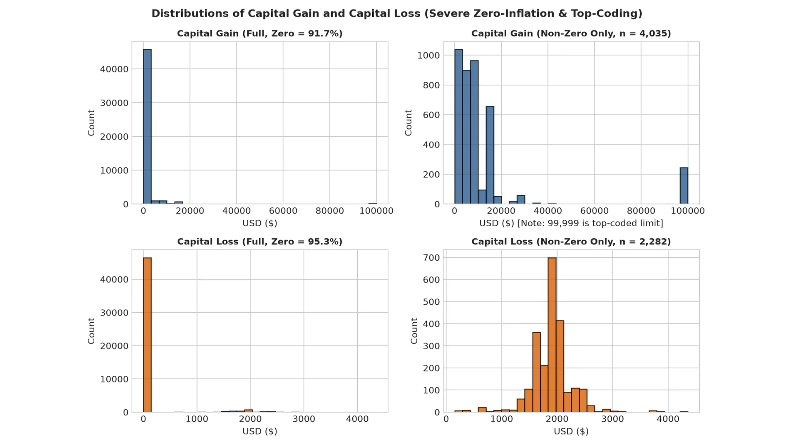
Full and non-zero histograms illustrate extreme zero-inflation (`91.7%` zero in `capital-gain` and `95.3%` zero in `capital-loss`) together with the census top-coding spike at `$99,999` among the `4,035` non-zero capital-gain records.

### 11. Test-Set ROC & Precision-Recall Curves
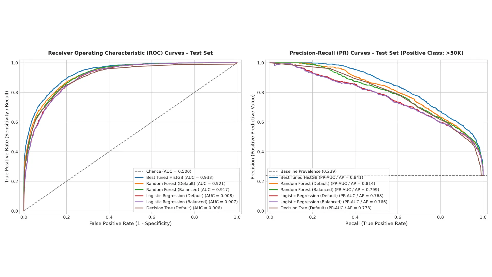
Multi-model ROC and Precision-Recall curves on the test set demonstrate `Best Tuned HistGB` achieving the highest discrimination (`ROC-AUC = 0.933`) and maintaining superior precision across recall thresholds (`PR-AUC = 0.841` vs. `0.239` baseline prevalence).

### 12. Subgroup Fairness Audit Across Sex and Race
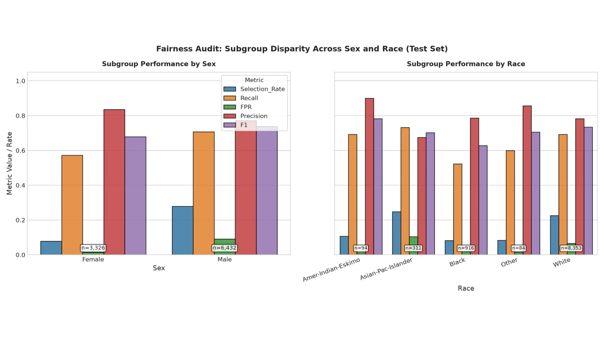
Grouped bar charts quantify disparities in Selection Rate, Recall, FPR, Precision, and F1 across `Sex` (`Female` `n=3,326` vs. `Male` `n=6,432`) and `Race` (`White` `n=8,353`, `Black` `n=916`, `Asian-Pac-Islander` `n=311`, `Amer-Indian-Eskimo` `n=94`, `Other` `n=84`).

### 13. Multi-Metric Model Comparison on Held-Out Test Set
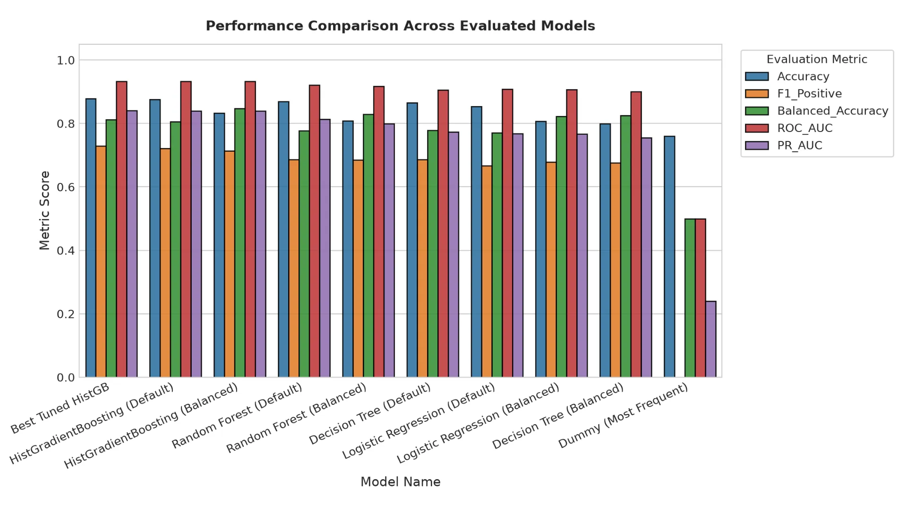
Side-by-side grouped bars compare all 10 models across Accuracy, `F1_Positive`, `Balanced_Accuracy`, `ROC_AUC`, and `PR_AUC`, visually contrasting the higher `F1_Positive`/`PR_AUC` of `Best Tuned HistGB` against the recall-boosted `Balanced` variants.

### 14. Numeric Correlation Heatmap & Best Model Confusion Matrix
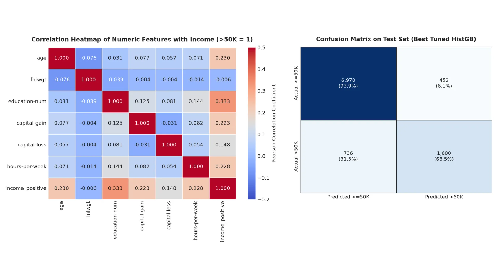
The Pearson correlation heatmap confirms `education-num` (`r = 0.333`) as the strongest linear numeric correlate and validates dropping `fnlwgt` (`r = -0.006`), while the test-set confusion matrix reports `93.9%` specificity (`6,970` TN, `452` FP) and `68.5%` recall (`1,600` TP, `736` FN) for `Best Tuned HistGB`.

## Prerequisites

- Python 3 environment compatible with the packages listed in [requirements.txt](requirements.txt)
- Core dependencies: `pandas>=2.2.0`, `numpy>=1.26.0`, `scikit-learn>=1.4.0`, `scipy>=1.12.0`
- Visualization and serialization: `matplotlib>=3.8.0`, `seaborn>=0.13.0`, `joblib>=1.3.0`
- Dashboard and testing: `streamlit>=1.35.0`, `pytest>=8.0.0`
- Local dataset file (`dataset/original/Adult.csv`) included in the repository (note: `resolve_data_path()` in `src/data_preprocessing.py` checks `Adult.csv` or `dataset/Adult.csv` by default, so pass `--filepath` or ensure path alignment if running from a subdirectory)
- Standard CPU execution is supported (no GPU or CUDA hardware required; `n_jobs=-1` uses available CPU cores)

## Installation & Setup

1. Clone the repository and navigate to the project root:
   ```bash
   git clone https://github.com/weztcy/Predicting-Annual-Income-from-Census-Data.git
   cd "Predicting Annual Income from Census Data"
   ```

2. Create and activate a Python virtual environment:
   ```bash
   python -m venv .venv
   # Windows PowerShell
   .\.venv\Scripts\Activate.ps1
   # Linux / macOS
   source .venv/bin/activate
   ```

3. Install all required dependencies from [requirements.txt](requirements.txt):
   ```bash
   pip install -r requirements.txt
   ```

## Usage & Execution

Run inference with the pre-serialized pipeline (`models/best_income_pipeline.joblib`), launch the interactive Streamlit dashboard, or re-run the automated test suite from the project root:

1. **Run CLI Inference on Custom Attributes**:
   ```bash
   python src/predict.py --age 42 --education-num 14 --marital-status Married-civ-spouse --occupation Exec-managerial --capital-gain 15000 --hours-per-week 50
   ```

2. **Launch the Interactive Streamlit Web App**:
   ```bash
   streamlit run streamlit/app.py
   ```
   *(Note: `streamlit/app.py` expects `reports/` and `src/` relative to its directory or project root; run from the appropriate working path if loading saved CSV/figure assets in the Performance and Fairness tabs.)*

3. **Run Automated Unit & Integration Tests**:
   ```bash
   pytest tests/test_pipeline.py -v
   ```

## Reproducibility & Execution

All modeling experiments use deterministic splitting and CV shuffling (`random_state=42`) alongside pinned minimum library versions in [requirements.txt](requirements.txt) and raw dataset provenance in [dataset/original/metadata.json](dataset/original/metadata.json). Note that `src/data_preprocessing.py` resolves `Adult.csv` at `Adult.csv` or `dataset/Adult.csv` while the repository stores the raw file at `dataset/original/Adult.csv`, and `train.py`/`evaluate.py` write outputs to `reports/` while exported CSVs and figures are stored under `dataset/` and `figures/`.

1. Verify data preprocessing and stratified split counts (`39,032` train / `9,758` test):
   ```bash
   python src/data_preprocessing.py
   ```

2. Reproduce 5-fold cross-validation, `GridSearchCV` hyperparameter tuning, and model serialization:
   ```bash
   python src/train.py
   ```

3. Reproduce held-out test-set comparison, 10-repeat permutation feature importance, subgroup fairness audit (with no-sensitive ablation), and evaluation figures:
   ```bash
   python src/evaluate.py
   ```

## Contributing

Contributions to improve pipeline modularity, add fairness mitigation strategies, or expand test coverage are welcome. Please follow this workflow:

1. Fork the repository.
2. Create a branch for the change.
3. Make the changes.
4. Run relevant checks or tests when available (`pytest tests/test_pipeline.py -v`).
5. Commit and push the branch.
6. Open a pull request with a clear explanation.

## License

This project is licensed under the MIT License.
See the [LICENSE](LICENSE) file for details.

## Author & Contact

**Yohanes Dimas Pratama**

- GitHub: [github.com/weztcy](https://github.com/weztcy)
- Portfolio: [yohanesdimas.com](https://yohanesdimas.com)
- LinkedIn: [linkedin.com/in/yohanes-dimas](https://www.linkedin.com/in/yohanes-dimas)
